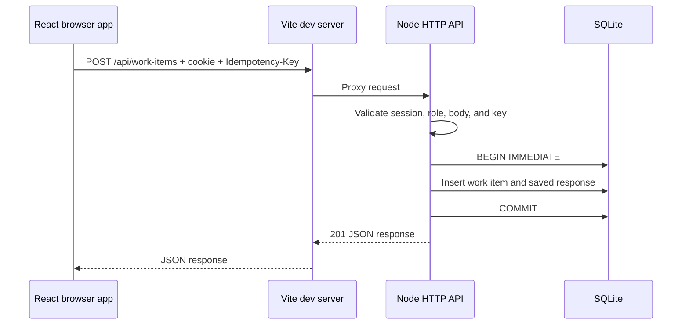

# Newtonite Ops — Interview Revision Guide

Use this guide to explain the implementation as it exists in this repository. The **plain explanation** is a beginner-friendly starting point; the **technical explanation** gives the vocabulary and details expected in an engineering interview. Recheck the source when you change a behavior.

## 1. Project overview

Newtonite Ops tracks team work items. An authenticated user can view the shared queue and add an item. Admins can create member accounts and assign work. Admins can update any item; members can update items they created or are assigned to. The API validates workflow changes and rejects stale updates.

**Plain explanation:** The browser shows the team’s work. The server checks who is signed in and whether they are allowed to make a change, then stores the change in SQLite.

**Technical explanation:** React 19 is built by Vite 7. During local development, Vite proxies `/api` to a Node 24 HTTP server. The API uses built-in `node:sqlite` and creates its schema on startup. The browser and API share the local origin, so session cookies travel with `fetch` requests.



## 2. Request flow and important files

| File | What it does |
| --- | --- |
| `src/main.jsx` | Mounts the React app and loads dashboard styles |
| `src/App.jsx` | Session check, login, member form, work item form, filters, status updates, and conflict reload |
| `src/styles.css` | Responsive dashboard and login layouts |
| `vite.config.js` | Sends `/api` requests to the local API during development |
| `server/index.js` | HTTP routes, body validation, cookie/session lookup, role checks, state transitions, idempotency, and responses |
| `server/db.js` | SQLite tables, indexes, constraints, and optional first-admin seed |
| `server/security.js` | Password hashing, password verification, and opaque session token helpers |
| `test/work-items.test.js` | Exercises the API over HTTP using an in-memory database |

For a work item update, React sends `PATCH /api/work-items/:id` with the item's current `version`. The API looks up the current row, checks authorization and allowed transition, and updates with `WHERE id = ? AND version = ?`. On success, React reloads the queue. On HTTP 409, React tells the user another change won and reloads the latest data.

## 3. REST API

**Plain explanation:** Each URL names a resource or action. The HTTP method says whether the client is reading, creating, or updating it. JSON carries the input and response.

**Technical explanation:** Routes are implemented directly with `node:http`; there is no Express router. `GET` reads health, the current profile, users, or work items. `POST` logs in, logs out, creates a member, or creates a work item. `PATCH` changes a work item. API errors use HTTP status codes such as 400, 401, 403, 404, and 409.

Know the request details:

- `POST /api/auth/login` accepts `email` and `password` and sets the session cookie.
- `GET /api/auth/me` returns the public profile for the current session.
- `POST /api/auth/logout` removes the presented session.
- `GET /api/users` and `POST /api/users` require an admin session.
- `POST /api/work-items` requires an `Idempotency-Key` header. It accepts `title`, optional `description`, `priority`, and optional `assigneeId`.
- `PATCH /api/work-items/:id` requires the current integer `version` and accepts editable item fields.
- `GET /api/work-items` requires a session and accepts optional `status` and `search` filters. It returns at most 200 items.

## 4. React

**Plain explanation:** React breaks the screen into components and redraws the parts whose data changes. A hook stores changing values such as the signed-in user, filters, and work items.

**Technical explanation:** `App` uses `useState` for form/session/UI state, `useEffect` for session and queue loading, `useCallback` for the queue loader, and `useMemo` for query strings and status counts. `SummaryCard` and `WorkItemRow` are small presentational components. The `api` helper sends same-origin requests and turns non-2xx responses into errors. The session token is HttpOnly, so JavaScript cannot read it.

**Trade-off:** The queue reloads after writes instead of optimistically editing local state. That keeps the displayed data aligned with server validation and version changes, at the cost of an extra request.

## 5. Node.js and HTTP

**Plain explanation:** Node runs the server and handles browser requests. The API reads JSON, checks it, talks to SQLite, and sends JSON back.

**Technical explanation:** `createAppServer` in `server/index.js` makes the server injectable with a database instance, which allows tests to use an in-memory database. `readJson` caps request bodies at 16 KiB and returns a 400 for invalid JSON. The server emits JSON errors and avoids returning internal exception details to the client.

The database driver here is synchronous. That keeps the dependency/setup footprint small, but a slow query blocks the Node event loop. This is one reason the current design is for a small local/demo deployment.

## 6. SQL schema and constraints

**Plain explanation:** SQLite keeps users, login sessions, work items, and retry records in related tables. Foreign keys connect an item to its creator and optional assignee.

**Technical explanation:** `server/db.js` creates `users`, `sessions`, `work_items`, and `idempotency_keys`, enables foreign keys, and uses WAL mode for a file database. CHECK constraints restrict roles, statuses, priorities, title length, and positive item versions. Indexes support status/update ordering, assignee lookup, session expiry, and idempotency cleanup.

This app uses no ORM or migration framework. `CREATE TABLE IF NOT EXISTS` initializes a new database; there is no versioned migration history yet.

## 7. Authentication and authorization

**Plain explanation:** Authentication answers “who are you?” Authorization answers “may you do this?” A password is checked at login, then the browser receives a cookie used on later requests. The server still checks the user's role and item relationship for each protected action.

**Technical explanation:** Passwords are hashed with `scryptSync` using a random per-user salt. Login creates a 32-byte random opaque token and stores only its SHA-256 digest in `sessions`. The raw token is sent in an HttpOnly, SameSite=Strict cookie with a seven-day expiry; production mode adds `Secure`. There are no JWTs or browser local-storage tokens.

Admins can list/create members, assign work, and update all items. Members can read the shared queue and update only items whose `created_by` or `assignee_id` matches their user id. The API enforces these rules; the UI's disabled controls only improve the experience.

**Limitations:** SameSite cookies are the current CSRF mitigation; there is no separate CSRF token or Origin allowlist. Login has no rate limiter. There is no password reset or invitation workflow. Do not treat these local-demo settings as production-ready identity management.

## 8. Transactions, concurrency, and idempotency

### Transactions

**Plain explanation:** A transaction groups several database changes so they succeed together or are rolled back together.

**Technical explanation:** Work item creation uses `BEGIN IMMEDIATE`, inserts the item, saves the replay response, prunes old idempotency entries, and commits. If an operation throws, the catch path rolls the transaction back. That makes the item and its retry record atomic.

### Optimistic concurrency

**Plain explanation:** Each item has a version number. If two people edit version 4, the first update changes it to 5. The second person's version-4 update is rejected instead of erasing the first change.

**Technical explanation:** The update statement increments `version` and includes both the item id and expected version in its `WHERE` clause. A zero-row update returns 409. The pre-update check also catches stale versions and reports the current version.

### Idempotency

**Plain explanation:** A client may not know whether a request succeeded if the network drops the response. It retries with the same key. The server returns the saved result rather than inserting a duplicate.

**Technical explanation:** The API requires an 8–128 character `Idempotency-Key`, hashes the key, scopes it to the user, and stores a hash of the normalized request plus the original status/body. A same-key/same-request retry replays the response. A same-key/different-request reuse returns 409. Old rows are pruned during later creates after 30 days.

The cleanup is opportunistic rather than scheduled; the database may retain expired key rows until another item is created. The transaction applies only to item creation, not every API route.

## 9. Testing and verification

**Plain explanation:** The integration test starts the real HTTP handler against a temporary database, makes requests, and checks the returned status and data.

**Technical explanation:** The built-in `node:test` runner and `fetch` exercise health, authentication, authorization, member creation, assignment, idempotent retries/mismatches, filtering, allowed/rejected transitions, optimistic conflict handling, and logout. The test uses `DatabaseSync(':memory:')` and an ephemeral loopback port. `npm run check` checks backend syntax; `npm run build` compiles the React client.

Verified from a fresh clone of the pushed `main` branch:

```powershell
npm ci
npm run check
npm test
npm run build
```

All four commands succeeded. Node prints an experimental warning for its built-in SQLite module; this warning is expected with the current runtime API.

## 10. Scalability and next steps

For multiple API instances, move from local SQLite to a shared database such as PostgreSQL, add explicit schema migrations, and keep the conditional version update and idempotency uniqueness constraint in the database. Add request logging, rate limiting, scheduled session/idempotency cleanup, pagination, password reset/invitations, and production static hosting with `/api` reverse proxying. Measure query and request behavior before adding caches or background jobs.

## 11. Likely interview questions

**Why use an HttpOnly cookie instead of local storage?**

The cookie keeps the raw session token inaccessible to browser JavaScript, reducing exposure to script injection. The browser sends it automatically to the same origin; the API validates the stored digest. SameSite is also part of the current CSRF defense.

**How do you prevent lost updates?**

The client sends the row version it read. The server updates only if that version still matches and increments it in the same SQL statement. If it does not match, the API returns 409 so the client can reload.

**How does an idempotent create work?**

The request includes a stable key. The server hashes the key and normalized body, then transactionally stores the created item and response. A retry with the same body replays that response; a different body under the same key conflicts.

**Where should authorization live?**

At the API boundary, because browser controls can be bypassed. The UI disables status editing for unauthorized rows, but `server/index.js` checks the role and item ownership/assignment before writing.

**What would you change before production?**

Replace experimental synchronous SQLite with a supported shared database and migrations; add rate limiting, request logging, scheduled cleanup, a formal CSRF strategy, pagination, password reset/invitations, and production static/API routing. Then add deployment and security tests.
