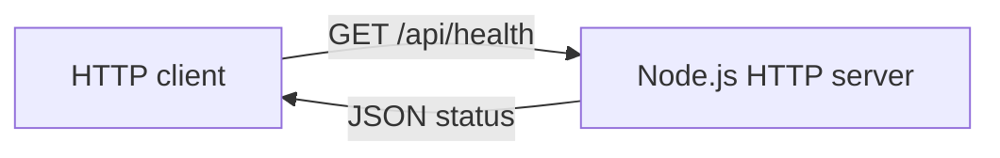

# Newtonite Ops

Newtonite Ops is an operations workflow application. This repository is being built in verified milestones. The first milestone provides a dependency-free Node.js API health check; work item management, persistence, authentication, and the React interface are not implemented yet.

## Project checklist

- [x] Project structure and setup instructions
- [x] `GET /api/health` API
- [ ] Work item lifecycle and persistence
- [ ] Authentication and authorization
- [ ] React operations dashboard
- [ ] Automated workflow and concurrency tests

## Technology and structure

- Node.js 20 or newer, using native ES modules and the built-in HTTP server
- No third-party runtime dependencies in the initial milestone

```text
.
├── server/
│   └── index.js       # HTTP server and health endpoint
├── .env.example      # Safe local configuration example
├── ENGINEERING_DECISIONS.md
└── package.json
```

## Architecture



## Prerequisites and Windows setup

Install Node.js 20 or newer. In PowerShell, from the repository root:

```powershell
Copy-Item .env.example .env
npm start
```

The server defaults to port 3000. To select another port in PowerShell:

```powershell
$env:PORT = '3100'
npm start
```

No package installation is required for this milestone. The `.env` file is provided as a local configuration example; Node's built-in server does not load it automatically yet, so set `PORT` in the shell as shown above.

## API

### `GET /api/health`

Returns HTTP 200 with JSON when the API process is running:

```json
{"status":"ok","service":"newtonite-ops"}
```

Other paths currently return HTTP 404 with `{"error":"Not found"}`.

## Database and demo accounts

No database, seed data, or demo account exists in this milestone.

## Checks

```powershell
npm run check
```

The check validates the server file's JavaScript syntax. A live health check can be performed by starting the server and requesting `http://localhost:3000/api/health`.

## Workflow and data diagrams

There is no workflow or database schema in the current milestone. Those diagrams will be added alongside the implementation.

## Known limitations and next steps

- The API has only one route and no persistence, authentication, or request logging.
- `.env` is not loaded automatically.
- Next: implement persisted work items and their allowed state transitions, then add the web interface and tests.
