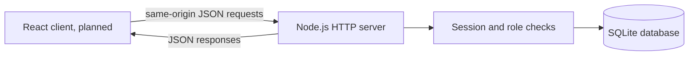
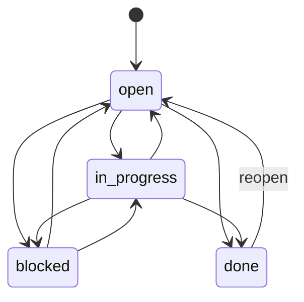
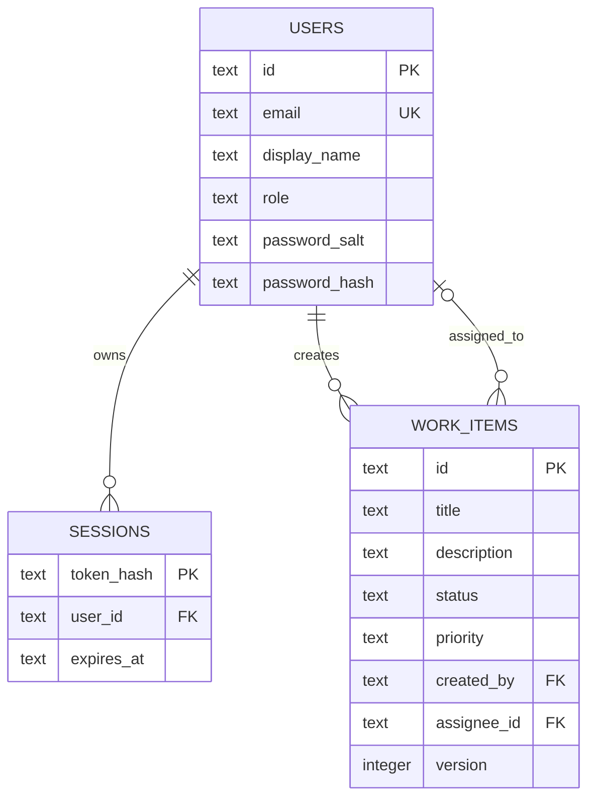

# Newtonite Ops

Newtonite Ops is an operations workflow application for tracking work items through a small, explicit lifecycle. The current milestone includes a Node.js REST API, SQLite persistence, cookie-based login sessions, role-aware work item updates, and optimistic concurrency checks. A React dashboard is the next milestone.

## Project checklist

- [x] Project structure, setup instructions, and `GET /api/health`
- [x] SQLite users, sessions, and work item schema
- [x] Login/logout and authenticated work item API
- [x] Work item status transitions and version conflict checks
- [ ] React operations dashboard
- [x] Automated API workflow and concurrency test

## Technology and structure

- Node.js 24 or newer, using native ES modules, `node:http`, and built-in `node:sqlite`
- No third-party runtime dependencies
- `node:sqlite` currently emits Node's experimental API warning

```text
.
├── server/
│   ├── db.js          # SQLite schema, connection setup, and optional admin seed
│   ├── index.js       # HTTP routes, validation, sessions, and workflow rules
│   └── security.js    # Password hashing and opaque session token helpers
├── test/
│   └── work-items.test.js
├── .env.example       # Safe local configuration template
├── ENGINEERING_DECISIONS.md
└── package.json
```

## Architecture



## Prerequisites and Windows setup

Install Node.js 24 or newer. In PowerShell, from the repository root:

```powershell
Copy-Item .env.example .env
$env:SEED_ADMIN_PASSWORD = Read-Host 'Set a unique local admin password'
npm start
```

The server reads `.env` automatically. The default seed email is `admin@newtonite.local`; the first start creates that local admin only when `SEED_ADMIN_PASSWORD` is set. Choose a unique local password of at least 12 characters, then sign in with the email and password you configured. The database is created at `data/opsflow.sqlite` by default. Never commit `.env` or real credentials.

The server defaults to port 3000. To select another port in PowerShell:

```powershell
$env:PORT = '3100'
npm start
```

No package installation is required. To run the integration test suite, use `npm test` from the repository root.

## API

### `GET /api/health`

Returns HTTP 200 with JSON when the API process is running:

```json
{"status":"ok","service":"newtonite-ops"}
```

Other paths currently return HTTP 404 with `{"error":"Not found"}`.

| Method | Path | Access | Behaviour |
| --- | --- | --- | --- |
| `GET` | `/api/health` | Public | Process health |
| `POST` | `/api/auth/login` | Public | Verify email/password; sets an HttpOnly, SameSite session cookie |
| `GET` | `/api/auth/me` | Session | Return the signed-in user's public profile |
| `POST` | `/api/auth/logout` | Public | Revoke the presented session and clear its cookie |
| `GET` | `/api/work-items` | Session | List up to 200 items; optional `status` and `search` filters |
| `POST` | `/api/work-items` | Session | Create an item with a title, optional description/priority and optional assignee |
| `PATCH` | `/api/work-items/:id` | Session | Update fields; requires the current integer `version` in the JSON body |

The seeded admin can update any item and assign it to an existing user. A member can update items they created or are assigned to. Status values are `open`, `in_progress`, `blocked`, and `done`; priorities are `low`, `medium`, and `high`. Updates that use an old version return HTTP 409, as do disallowed transitions. Passwords are stored as salted scrypt hashes, and only SHA-256 digests of opaque session tokens are stored.

## Workflow and database diagrams





## Database and demo accounts

For local demo use, set a unique `SEED_ADMIN_PASSWORD` in `.env` (at least 12 characters). The app creates `admin@newtonite.local` on first startup unless you change `SEED_ADMIN_EMAIL`. There is no shared demo password and no member creation screen yet. Users can be provisioned by inserting a properly hashed user through a future admin feature; do not place passwords in source control.

## Checks

```powershell
npm run check
npm test
```

Verified for this milestone: `npm run check` passes and `npm test` passes (1 integration test covering health, login/logout, authorization, work item creation/filtering, valid and invalid transitions, and stale-version rejection). The test opens a temporary in-memory SQLite database and an ephemeral localhost HTTP server.

## Known limitations and next steps

- There is no React interface, member provisioning flow, request logging, or pagination beyond a 200-item cap.
- The built-in SQLite API is experimental in Node 24; for larger deployments, use a supported database service and migration tooling.
- Session cleanup is not scheduled; expired sessions are rejected when used but retained until logout or database maintenance.
- Next: build the React dashboard and improve user provisioning and operational observability.
