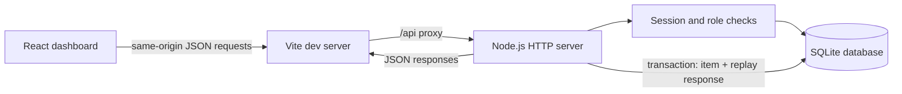
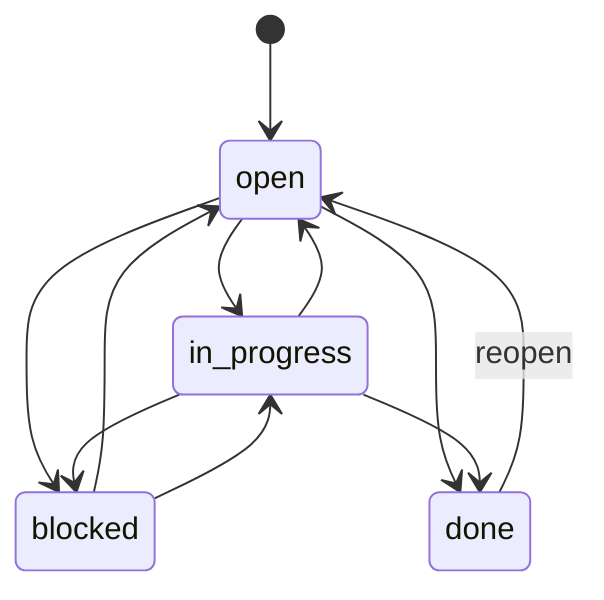
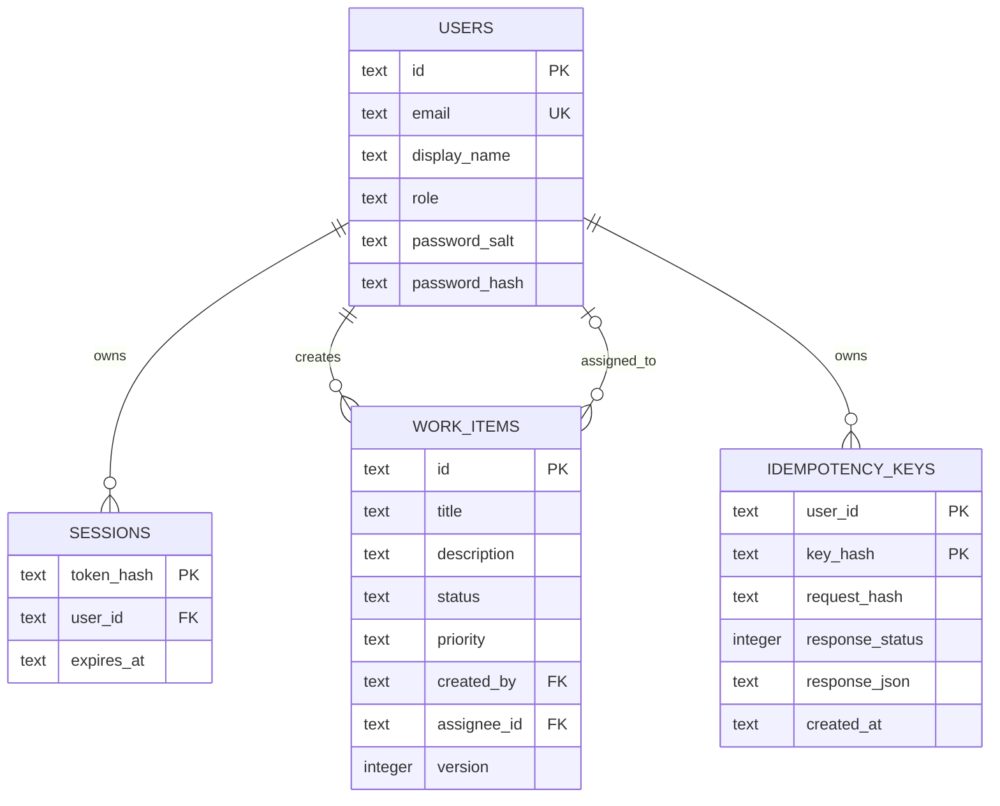

# Newtonite Ops

Newtonite Ops is an operations workflow application for tracking work items through a small, explicit lifecycle. It includes a Node.js REST API, SQLite persistence, cookie-based sessions, role-based access, transactional idempotent item creation, optimistic concurrency checks, and a React dashboard.

## Project checklist

- [x] Project structure, setup instructions, and `GET /api/health`
- [x] SQLite users, sessions, and work item schema
- [x] Login/logout and authenticated work item API
- [x] Work item status transitions and version conflict checks
- [x] Admin member provisioning and work assignment
- [x] Transactional idempotent work item creation
- [x] React dashboard with sign-in, team management, search/filter, and status updates
- [x] Automated API workflow, authorization, and concurrency test

## Technology and structure

- Node.js 24 or newer, using native ES modules, `node:http`, and built-in `node:sqlite`
- React 19 and Vite 7 for the browser interface
- `node:sqlite` currently emits Node's experimental API warning

```text
.
├── server/
│   ├── db.js          # SQLite schema, connection setup, and optional admin seed
│   ├── index.js       # HTTP routes, validation, sessions, and workflow rules
│   └── security.js    # Password hashing and opaque session token helpers
├── test/
│   └── work-items.test.js
├── src/
│   ├── App.jsx         # Login and operations dashboard
│   ├── main.jsx        # React entry point
│   └── styles.css      # Responsive dashboard styles
├── index.html
├── vite.config.js      # Local API proxy
├── .env.example       # Safe local configuration template
├── ENGINEERING_DECISIONS.md
└── package.json
```

## Architecture



## Prerequisites and Windows setup

Install Node.js 24 or newer. In PowerShell, from the repository root:

```powershell
npm ci
Copy-Item .env.example .env
$env:SEED_ADMIN_PASSWORD = Read-Host 'Set a unique local admin password'
npm start
```

Keep that PowerShell window running for the API. Open a second PowerShell window in the repository and run `npm run dev` to start the React dashboard at `http://localhost:5173`.

The API reads `.env` automatically. The default seed email is `admin@newtonite.local`; the first API start creates that local admin only when `SEED_ADMIN_PASSWORD` is set. Choose a unique local password of at least 12 characters, then sign in with the email and password you configured. The database is created at `data/opsflow.sqlite` by default. Never commit `.env` or real credentials.

The server defaults to port 3000. To select another port in PowerShell:

```powershell
$env:PORT = '3100'
npm start
```

### Environment variables

| Variable | Default | Purpose |
| --- | --- | --- |
| `PORT` | `3000` | Node API listen port |
| `DATABASE_PATH` | `./data/opsflow.sqlite` | SQLite database file path; `:memory:` is useful for tests |
| `SEED_ADMIN_EMAIL` | `admin@newtonite.local` | Email used when creating the first local admin |
| `SEED_ADMIN_PASSWORD` | unset | Optional first-start admin password; must be at least 12 characters |

For backend development, run `npm run dev:api` instead of `npm start` to restart the API when files change.

## API

### `GET /api/health`

Returns HTTP 200 with JSON when the API process is running:

```json
{"status":"ok","service":"newtonite-ops"}
```

Other paths currently return HTTP 404 with `{"error":"Not found"}`.

| Method | Path | Access | Behaviour |
| --- | --- | --- | --- |
| `GET` | `/api/health` | Public | Process health |
| `POST` | `/api/auth/login` | Public | Verify email/password; sets an HttpOnly, SameSite session cookie |
| `GET` | `/api/auth/me` | Session | Return the signed-in user's public profile |
| `POST` | `/api/auth/logout` | Public | Revoke the presented session and clear its cookie |
| `GET` | `/api/users` | Admin | List team members and admins |
| `POST` | `/api/users` | Admin | Create a member using `displayName`, `email`, and a password of at least 12 characters |
| `GET` | `/api/work-items` | Session | List up to 200 items; optional `status` and `search` filters |
| `POST` | `/api/work-items` | Session | Create an item with a title, optional description/priority/assignee, and an `Idempotency-Key` header |
| `PATCH` | `/api/work-items/:id` | Session | Update fields; requires the current integer `version` in the JSON body |

The seeded admin can add members, update any item, and assign items to existing members. A member can update items they created or are assigned to. Status values are `open`, `in_progress`, `blocked`, and `done`; priorities are `low`, `medium`, and `high`. Updates that use an old version return HTTP 409, as do disallowed transitions. Passwords are stored as salted scrypt hashes, and only SHA-256 digests of opaque session tokens are stored.

The item create route requires a unique idempotency key (8–128 letters, digits, or `._~-`). Within one SQLite transaction, the server saves the item and the response associated with that key. A retry with the same key and body replays the original response; reusing the key with a different body returns HTTP 409. Old keys are pruned after 30 days during later create requests.

## Workflow and database diagrams





## Database and demo accounts

For local demo use, set a unique `SEED_ADMIN_PASSWORD` in `.env` (at least 12 characters). The app creates `admin@newtonite.local` on first startup unless you change `SEED_ADMIN_EMAIL`. There is no shared demo password. Admins can provision members from the dashboard; the API stores their salted scrypt hashes and never returns the password. Do not place passwords in source control.

## Checks

```powershell
npm run check
npm test
```

Verified for this milestone: `npm run check` passes, `npm test` passes (1 integration test covering health, login/logout, admin/member access, member creation, idempotent replay and mismatch, work item filtering, valid and invalid transitions, and stale-version rejection), and `npm run build` succeeds. The test uses a temporary in-memory SQLite database and an ephemeral localhost HTTP server.

`npm run build` also succeeds and creates the production frontend files under `dist/`. The current Node server serves API routes only; production deployment must serve `dist/` through a static host or reverse proxy and route `/api` to the Node API.

## Known limitations and next steps

- There is no request logging, rate limiting, or pagination beyond a 200-item cap.
- The built-in SQLite API is experimental in Node 24; for larger deployments, use a supported database service and migration tooling.
- Expired sessions remain until logout or manual database maintenance. Idempotency keys older than 30 days are pruned when later work items are created; neither cleanup has a scheduled maintenance task.
- Next: add request logging, rate limiting, and operational monitoring before considering a shared production database.
